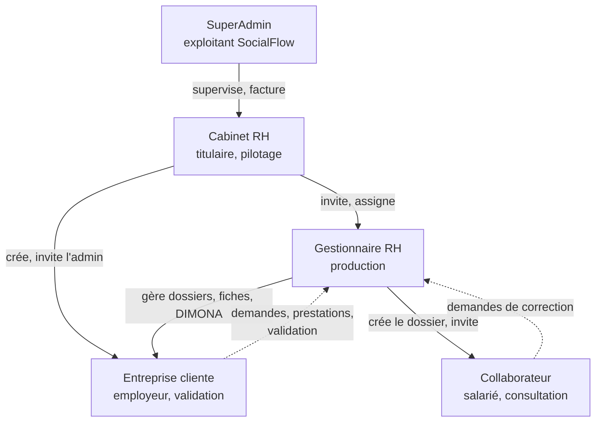
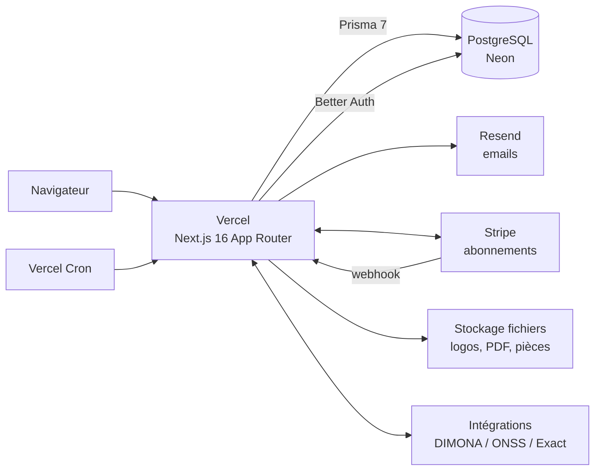
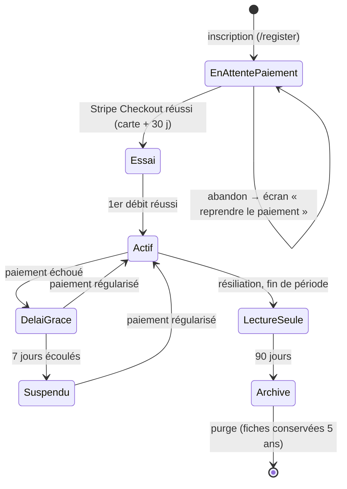
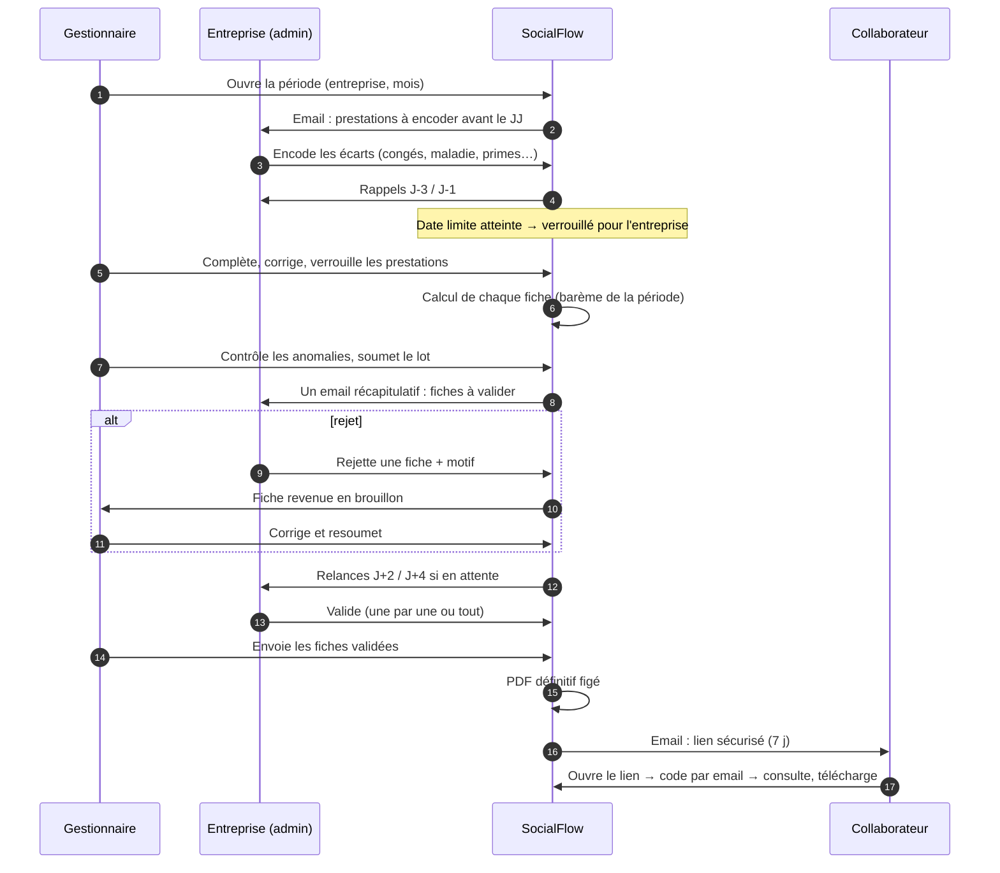
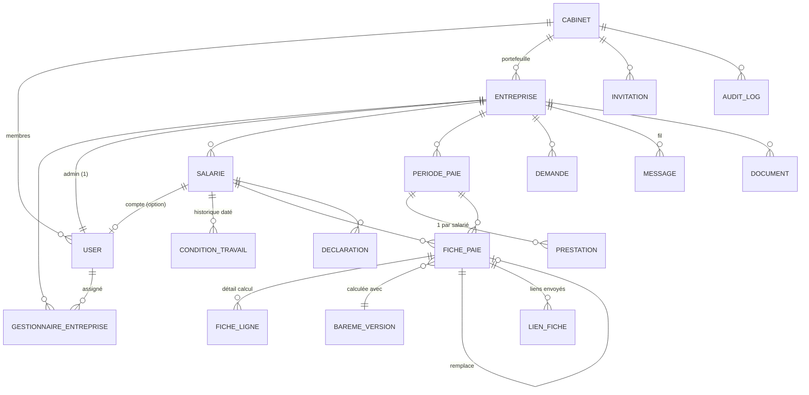

# Fonctionnement de SocialFlow

> Vue d'ensemble de bout en bout. Pour le détail d'un rôle, voir `roles/` ; pour la justification d'une règle, voir [DECISIONS.md](DECISIONS.md) (références `Dxx`).

## 1. En une phrase

SocialFlow est un **SaaS multi-tenant** qui permet à des **cabinets de paie belges** de produire chaque mois les fiches de paie de leurs **entreprises clientes**, de les faire **valider par l'employeur**, de les **remettre aux salariés** de façon sécurisée et de gérer les **déclarations sociales** (DIMONA, ONSS, C4).

## 2. Qui fait quoi



| Rôle | Il est… | Il fait | Il ne fait jamais |
|---|---|---|---|
| SuperAdmin | L'exploitant | Supervise cabinets, comptes, plans, facturation, monitoring, barèmes | Voir des données de paie (D8) |
| Cabinet RH | Le client payant (1 compte par cabinet) | Abonnement, équipe, portefeuille d'entreprises, branding, modèles d'emails | Produire des fiches, voir des salaires (D3, D26) |
| Gestionnaire RH | Le producteur | Dossiers salariés, prestations, fiches, envoi, déclarations | Toucher une entreprise non assignée |
| Entreprise cliente | L'employeur (1 admin) | Prestations, validation des fiches, demandes, messagerie | Modifier un dossier ou une fiche |
| Collaborateur | Le salarié | Consulter ses fiches et documents, demander une correction, export RGPD | Voir autre chose que ses données |

## 3. Architecture technique



| Couche | Emplacement | Règle |
|---|---|---|
| Pages (Server Components) | `apps/web/src/app/**/page.tsx` | Protégées par `requireSession({ role })` |
| API (Route Handlers) | `apps/web/src/app/api/**/route.ts` | Session (401) → rôle (403) → périmètre (404) → validation Zod (400) → action → audit |
| Accès aux données | `apps/web/src/lib/*-data.ts` | Toujours un paramètre de périmètre (`cabinetId`, liste d'entreprises, `collaborateurId`) |
| Métier pur | `apps/web/src/lib/payroll/` | Fonctions pures testées, sans accès base |
| Intégrations | `apps/web/src/lib/integrations/` | Derrière une interface, avec une version simulée et une version réelle |
| Tâches planifiées | `apps/web/src/app/api/cron/*` + `vercel.json` | Protégées par `CRON_SECRET`, idempotentes |

Stockage de fichiers : **Vercel Blob** derrière `StorageGateway` (D54, `modules/stockage.md`).

## 4. Isolation des données (multi-tenant)

Le **tenant** est le cabinet. Chaque requête est filtrée selon la chaîne suivante, **côté serveur, à chaque requête** (jamais d'après des listes stockées dans la session) :

```
SuperAdmin   : tout, SAUF les tables métier (entreprises, salariés, fiches, documents, messages)
Cabinet RH   : WHERE cabinetId = user.cabinetId   (tables métier : compteurs et statuts seulement)
Gestionnaire : WHERE cabinetId = user.cabinetId AND entrepriseId IN (assignations actuelles)
Entreprise   : WHERE entrepriseId = entreprise de l'utilisateur
Collaborateur: WHERE collaborateurId = dossier de l'utilisateur
```

Règles :
- Le client n'envoie **jamais** `cabinetId`, `role` ou `entrepriseId` d'autorité : le serveur les déduit de la session.
- Ressource hors périmètre → **404** (on ne révèle pas son existence).
- Toute nouvelle route arrive avec un **test d'intégration d'isolation** : un utilisateur du cabinet A n'accède à rien du cabinet B, un gestionnaire à rien d'une entreprise non assignée.
- Données sensibles (NISS, IBAN) **chiffrées en base**, masquées à l'affichage, et chaque dévoilement est journalisé.

## 5. Cycle de vie d'un cabinet



Pendant `Suspendu` et `LectureSeule`, les portails Entreprise et Collaborateur restent consultables (D29). Une suspension manuelle par le SuperAdmin n'est jamais levée par un paiement.

## 6. Mise en place d'un client (onboarding)

1. Le **cabinet** s'inscrit, choisit un plan et paie via Stripe Checkout (essai de 30 jours).
2. Il règle son identité, son branding et ses modèles d'emails.
3. Il **invite ses gestionnaires** (7 jours de validité).
4. Il **crée une entreprise cliente**, lui **assigne** au moins un gestionnaire et **invite son administrateur**.
5. Le **gestionnaire** crée les **dossiers salariés** (à la main ou par CSV) : chaque création génère une **DIMONA IN**.
6. Facultatif : le gestionnaire **invite les salariés** au portail.

## 7. Le cycle mensuel de paie

C'est le cœur de l'application.



### États d'une fiche

| Statut | Signification | Transition suivante | Par qui |
|---|---|---|---|
| `BROUILLON` | En préparation, recalculable | → `A_VALIDER` | Gestionnaire |
| `A_VALIDER` | Chez l'employeur | → `VALIDEE`, ou → `BROUILLON` avec motif | Entreprise |
| `VALIDEE` | Approuvée, prête à partir | → `ENVOYEE` | Gestionnaire |
| `ENVOYEE` | Remise au salarié, **figée pour toujours** | → `REMPLACEE` (par une rectificative) | Système |
| `REMPLACEE` | Corrigée par une fiche rectificative | — | — |

Invariants : une seule fiche active par salarié et par mois ; aucun champ modifiable hors `BROUILLON` ; chaque transition est horodatée, attribuée et journalisée.

### Calcul
Fonctions pures dans `lib/payroll/`, montants en **centimes entiers**, **barèmes versionnés** par date de validité ; chaque fiche mémorise la version utilisée et le détail de chaque ligne. Ordre et règles : voir `roles/03-gestionnaire-rh.md` § 6.3.

## 8. Déclarations sociales

| Déclaration | Déclencheur | Fréquence |
|---|---|---|
| DIMONA IN / OUT / UPDATE | Entrée, sortie ou changement de dates d'un salarié | À l'événement, **avant** le premier jour de travail pour l'IN |
| Déclaration trimestrielle ONSS (DmfA) | Fiches envoyées du trimestre | Trimestrielle |
| C4 | Sortie d'un salarié | À l'événement |
| Fiche fiscale annuelle (281.10) | Fiches de l'année | Annuelle **[périmètre à confirmer]** |

Toutes passent par une interface `DeclarationGateway`. Pour le TFE, l'implémentation est **simulée** à partir de la documentation officielle publique (D50) ; une implémentation réelle pourra s'y brancher plus tard sans changer le reste. Statuts communs : `A_ENVOYER → ENVOYEE → ACCEPTEE | REFUSEE (motif)`.

## 9. Modèle de données cible

Légende : ✅ existe · 🟡 en cours · 🆕 à créer · ✏️ à modifier



| Modèle | État | Contenu essentiel |
|---|---|---|
| `User`, `Session`, `Account`, `Verification`, `TwoFactor`, `RateLimit` | ✅ | Better Auth. ✏️ Retirer `plan`/`billingPeriod` (déplacés sur `Cabinet`) |
| `Cabinet` | ✅ ✏️ | + `planId`, `billingPeriod`, `billingStatus`, `trialEndsAt`, `currentPeriodEnd`, `suspendedReason`, identité (TVA, adresse, contact), branding (`displayName`, `logoUrl`, `colorPrimary`, `colorSecondary`) |
| `PricingPlan` | ✅ ✏️ | + `maxEntreprises`, `maxUtilisateurs`, `maxStorageMb` (null = illimité), droits de fonctionnalités (`integrations`, `whiteLabel`) |
| `Invitation` | ✅ ✏️ | `token` → `tokenHash` ; + `entrepriseId`, `salarieId` (selon le rôle invité) |
| `AuditLog` | ✅ ✏️ | + `entrepriseId`, `ipAddress`, `userAgent`, `metadata Json` |
| `Entreprise` | 🆕 | Raison sociale, n° d'entreprise (unique par cabinet), adresse, contact, `adminUserId`, jour limite des prestations, `deletedAt` |
| `GestionnaireEntreprise` | 🆕 | N:M gestionnaire ↔ entreprise |
| `Salarie` | 🆕 | Dossier : identité, NISS et IBAN chiffrés, statut employé/ouvrier, CP, type de contrat, entrée/sortie, données fiscales, `userId?` |
| `ConditionTravail` | 🆕 | Historique daté : régime, fraction d'occupation, rémunération, fonction |
| `PeriodePaie` | 🆕 | Entreprise + mois : statut de clôture, date limite effective |
| `Prestation` | 🆕 | Période + salarié : jours/heures, congés, maladie, fériés, heures sup, primes ; encodé par qui |
| `FichePaie` | 🆕 | Statut, montants (centimes), `baremeVersionId`, `remplaceFicheId`, motif de rejet, horodatages, `pdfUrl` figé |
| `FicheLigne` | 🆕 | Libellé, base, taux, montant : traçabilité du calcul |
| `BaremeVersion` | 🆕 | Paramètres de calcul JSON, `valideDepuis`, statut `A_VERIFIER / ACTIF / RETIRE` |
| `LienFiche` | 🆕 | `tokenHash`, expiration 7 j, OTP haché, essais restants |
| `Declaration` | 🆕 | Type, salarié, statut, référence externe, motif de refus, charge utile |
| `Demande` | 🆕 | Type, auteur (entreprise ou collaborateur), données, statut, motif de refus |
| `Message` | 🆕 | Fil par entreprise, auteur, texte, pièces jointes, lu par |
| `Document` | 🆕 | Entreprise ou salarié, type, fichier, taille (pour le quota de stockage) |
| `EmailTemplate` | 🆕 | Cabinet + type : sujet, corps, variables |
| `Notification` | 🆕 | Destinataire, type, message, lien, `readAt` |
| `Echeance` | 🆕 | Calendrier : type, date, entreprise ou cabinet, rappels |
| `WebhookEvent` | 🆕 | Idempotence Stripe : `eventId` unique |

Conventions : statuts en **chaînes MAJUSCULES sans accent** (`A_VALIDER`, pas `À VALIDER`) ; soft-delete via `deletedAt` ; montants en `Int` (centimes). Les statuts actuels en minuscules (`actif`, `suspendu`) sont conservés tels quels pour ne pas casser l'existant.

## 10. Emails envoyés

| Événement | Destinataire | Expéditeur / modèle |
|---|---|---|
| Vérification d'email, lien magique, code, réinitialisation, alertes de sécurité | Utilisateur | SocialFlow (✅ existe) |
| Invitation gestionnaire / admin entreprise / collaborateur | Invité | Au nom du cabinet, modèle du cabinet |
| Prestations à encoder, rappels J-3 / J-1 | Admin entreprise | Cabinet |
| Fiches à valider (récapitulatif), relances J+2 / J+4 | Admin entreprise | Cabinet |
| Validation en retard, fiche rejetée | Gestionnaire | SocialFlow |
| Fiche disponible (lien 7 j) + code OTP | Salarié | Cabinet |
| Demande reçue / traitée | Gestionnaire / auteur | Cabinet |
| Essai bientôt fini, paiement échoué, suspension | Cabinet + SuperAdmin | SocialFlow |
| Nouvelle version de barème à vérifier | SuperAdmin | SocialFlow |

Tout email part par Resend (pas de SMTP de cabinet, D30) ; pour les emails « au nom du cabinet », le nom d'expéditeur est celui du cabinet et le `Reply-To` son adresse de contact.

## 11. Tâches planifiées

| Tâche | Fréquence | État |
|---|---|---|
| Purge des comptes archivés (> 90 j) | Quotidienne 03:00 | ✅ |
| Purge des cabinets archivés (> 90 j) | Quotidienne 04:00 | ✅ |
| Purge des sessions expirées | Quotidienne 05:00 | ✅ |
| Passage en `IMPAYE` des cabinets en délai de grâce dépassé (D57) | Quotidienne 06:00 | ✅ |
| Rappels prestations (J-3, J-1) et validation (J+2, J+4) | Quotidienne | 🆕 |
| Rappels d'échéances du calendrier (J-7, J-3, J-1) | Quotidienne | 🆕 |
| Vérification des nouveaux barèmes officiels | Hebdomadaire | 🆕 |
| Expiration des invitations et des liens de fiche | Quotidienne | 🆕 |

Toutes **idempotentes** (rejouables sans effet double) et protégées par `CRON_SECRET`.

## 12. Conservation des données

| Donnée | Durée | Après |
|---|---|---|
| Fiches de paie, dossiers salariés, déclarations | 5 ans après la période (légal) | Suppression |
| Compte utilisateur archivé | 90 jours | Purge (✅) |
| Cabinet archivé | 90 jours | Purge des données non légales (✅ partiel) |
| Journal d'audit | ⚠️ À fixer (les anciens documents divergent : 90 j / 3 ans / illimité) | Anonymisation |

## 13. Glossaire

| Terme | Définition |
|---|---|
| **ONSS** | Office national de sécurité sociale : perçoit les cotisations sociales |
| **DIMONA** | Déclaration immédiate de l'emploi : chaque entrée et sortie de travailleur, avant le début du travail |
| **DmfA** | Déclaration trimestrielle multifonctionnelle des salaires et du temps de travail à l'ONSS |
| **Précompte professionnel** | Impôt retenu à la source sur le salaire, calculé par la formule-clé du SPF Finances |
| **Cotisation spéciale de sécurité sociale** | Retenue supplémentaire fonction des revenus du ménage |
| **Bonus à l'emploi** | Réduction des cotisations personnelles pour les bas salaires |
| **CP (commission paritaire)** | Secteur d'activité qui fixe salaires minimums et règles ; CP 200 (employés), CP 100 (ouvriers) |
| **Pécule de vacances** | Rémunération liée aux vacances (simple et double pécule pour les employés, caisse de vacances pour les ouvriers) |
| **C4** | Certificat de chômage remis au travailleur à la fin du contrat |
| **281.10** | Fiche fiscale annuelle des rémunérations |
| **NISS** | Numéro d'identification de la sécurité sociale (numéro national) |
| **Fiche rectificative** | Nouvelle fiche qui remplace une fiche déjà envoyée, sans jamais modifier cette dernière |
| **Tenant** | Unité d'isolation des données : le cabinet |
